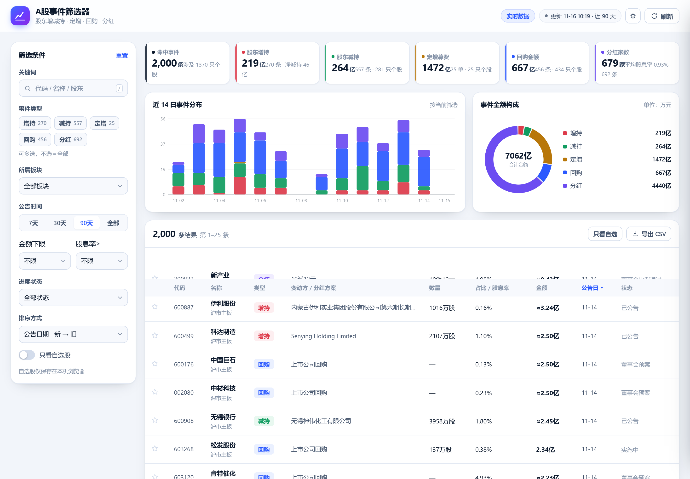

# A股事件筛选器

> 按股东增减持、定增、回购、分红筛选 A 股的静态看板；手机/电脑自适应，数据每工作日 16:40（北京时间）更新。
> 线上地址：<https://wind866.github.io/astock-screener/>



## 快速开始

1. Fork / Clone 仓库（必须包含隐藏目录 `.github/workflows/`）。
2. 飞书群添加自定义机器人；开启加签时记下密钥。
3. 在 **Settings → Secrets and variables → Actions** 配置：

| Secret | 必填 | 用途 |
| --- | --- | --- |
| `FEISHU_WEBHOOK` | 是 | 机器人 Webhook |
| `FEISHU_SECRET` | 否 | 加签密钥；开启加签时必填 |
| `PAGE_URL` | 建议 | 看板地址，用于飞书卡片跳转 |
| `ALERT_WEBHOOK` / `ALERT_SECRET` | 否 | 独立告警机器人及其加签密钥 |

4. Settings → Pages → Source 选择 **GitHub Actions**；Actions → Workflow permissions 选择 **Read and write**。
5. Actions → `daily.yml` → Run workflow 手动验证一次。

## 运行节奏

| 北京时间 | 任务 | 说明 |
| --- | --- | --- |
| 16:40（工作日） | 主档采集 + 推送 + 回写数据 | `daily.yml` |
| 18:40 / 20:40 / 22:40 | cron 兜底档 | 按档期 + 台账判重，不重复推送 |

> `daily.yml` 内置 deploy job：用 `GITHUB_TOKEN` 的提交不会触发 `pages.yml`，因此数据回写后必须在同一 run 内重新发布 Pages。

## 本地开发

```bash
pip install -r requirements.txt
python scripts/fetch_data.py            # 真实数据
python scripts/fetch_data.py --demo     # 演示数据
python -m http.server 8000
```

也可直接双击 `index.html`：数据由 `data/latest.js` 内嵌，无需服务器。
测试：`python -m unittest discover -s tests`。

## 目录结构

- `index.html` / `assets/`：纯前端看板
- `scripts/`：采集、选股池接入、飞书推送、台账
- `data/`：最新数据与按日归档
- `docs/bigapush-integration/`：与 BIGApush 选股池交叉的接入说明

## 安全说明

- Webhook 与密钥只通过 Secrets / 环境变量提供；CI 会拦截误提交的真实 Webhook。
- 加签要么两个机器人都开，要么都不开；只开一半会导致业务推送与告警同时静默。
- 未配置 Webhook 时任务判红，不会把「没推送」记成成功。

## 排错

- **看板 404**：Pages Source 未选 GitHub Actions；改完后需重新 Run，不能用旧 run 的 Re-run。
- **收到重复卡片**：检查 `.push-state/ledger.json` 是否被清除；台账跨运行共享。
- **接口取数失败**：先跑 `python scripts/fetch_data.py --demo` 验证前端，再排查 AKShare 接口。

## 免责声明

本工具仅用于信息聚合与研究复盘，不构成投资建议。市场有风险，投资需谨慎。

## License

MIT

## 详细文档

- [完整说明与排错](docs/README-full.md)
- [BIGApush 选股池接入](docs/bigapush-integration/README.md)
